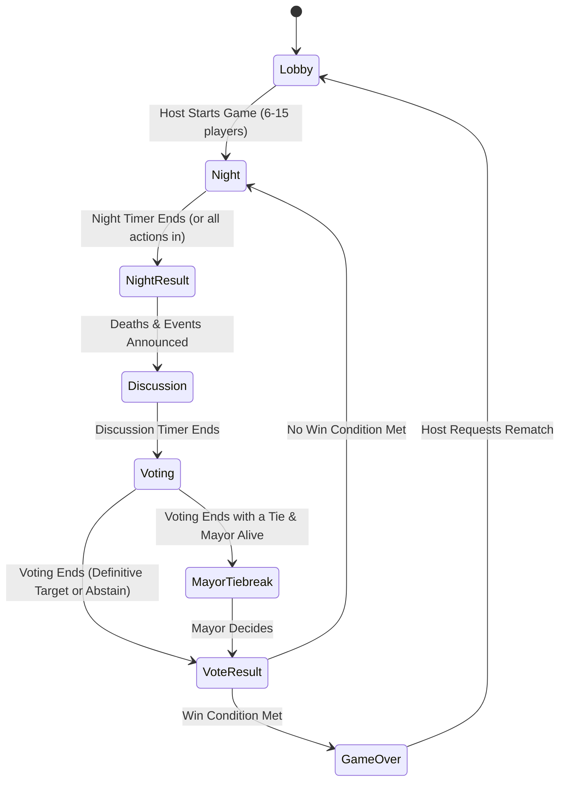

# Ontorale (অন্তরালে)

[](https://github.com/zahin002/ontorale/actions/workflows/ci.yml)
[](https://opensource.org/licenses/MIT)
[](https://nodejs.org/)
[](https://www.typescriptlang.org/)
[](https://pnpm.io/)

**Ontorale (অন্তরালে)** is an online multiplayer social-deduction game (Citizens vs. Mafia) built for fast, accessible, and thrilling multiplayer sessions. Designed specifically with first-class Bengali typography and international English support, it offers a secure, server-authoritative engine, synchronized audio/video voice channels via LiveKit, and real-time WebSocket communication.

---

## Table of Contents

- [Features](#features)
- [Architecture & Monorepo Structure](#architecture--monorepo-structure)
- [Roles & Rules Engine](#roles--rules-engine)
  - [Team Citizens](#team-citizens)
  - [Team Mafia](#team-mafia)
  - [Game Phase Lifecycle](#game-phase-lifecycle)
  - [Win Conditions](#win-conditions)
- [Tech Stack](#tech-stack)
- [Environment Variables](#environment-variables)
- [Quick Start & Local Development](#quick-start--local-development)
- [Test Suites & Coverage](#test-suites--coverage)
- [Docker & Production Deployment](#docker--production-deployment)
- [Milestone Roadmap & Implementation Status](#milestone-roadmap--implementation-status)
- [License](#license)

---

## Features

- **Authoritative Server Architecture:** Game logic, timers, role distribution, and event outcomes are computed exclusively on the server. Clients receive only personalized state projections—zero secret leakage.
- **Bilingual Interface (i18n):** Native Bengali (default) paired with English, rendered using high-legibility Google Noto Sans Bengali typography.
- **Dynamic Player Scaling:** Accommodates 6 to 15 players with mathematically balanced role compositions.
- **Voice Communication:** Integrated LiveKit WebRTC audio channels featuring an authoritative per-phase mute matrix (private Mafia whispering at night, open public discussion during the day).
- **Graceful Disconnects & Session Restore:** Session tokens allow players to reconnect seamlessly if their browser refreshes or connectivity drops; intentional leaves trigger role reveals and public death notices.
- **Zero-Downtime Deployment:** Multi-stage Alpine containerization paired with Caddy reverse proxy and rollback-enabled deployment script.

---

## Architecture & Monorepo Structure

The repository is organized as a lightweight pnpm monorepo:

```
ontorale/
├── packages/
│   ├── shared/         # Pure, zero-dependency game rules engine & Zod schemas
│   ├── server/         # Express, Socket.IO, LiveKit provider & authoritative Game engine
│   └── client/         # React 18, Vite, Tailwind CSS, Lucide icons & Zustand store
├── e2e/                # Playwright full browser integration test suite (E1–E7)
├── deploy/             # Production deployment assets (Caddyfile, docker-compose, deploy.sh)
├── .github/workflows/  # CI/CD pipeline definition (verify, e2e, docker, deploy)
├── Dockerfile          # Multi-stage production container build
└── pnpm-workspace.yaml # Monorepo workspace configuration
```

---

## Roles & Rules Engine

### Team Citizens

### Team Citizens

| Role                     | Bengali Name  | Ability & Rules                                                                                                                                                                   |
| :----------------------- | :------------ | :-------------------------------------------------------------------------------------------------------------------------------------------------------------------------------- |
| **Citizen**              | সাধারণ নাগরিক | Votes during the day to identify and eliminate the Mafia.                                                                                                                         |
| **Doctor**               | ডাক্তার       | Chooses one player each night to protect from death (cannot protect self twice in a row).                                                                                         |
| **Police**               | পুলিশ         | Starts with 2 bullets; can choose to shoot one target each night until ammunition is depleted.                                                                                    |
| **Detective**            | গোয়েন্দা     | Investigates one player at night to uncover whether they are Mafia or Citizen (2 lifetime investigations limit).                                                                  |
| **Mayor**                | মেয়র         | Has daytime tiebreaker authority: if a vote ends in a tie, the Mayor selects who is eliminated.                                                                                   |
| **Constable / Habildar** | হাবিলদার      | Optional Citizen role. Night actions: shoot (1 bullet lifetime limit, Doctor can save), disable an alive Mafia member's abilities for 2 rounds (1-round cooldown), or do nothing. |

### Team Mafia

| Role         | Bengali Name  | Ability & Rules                                                                                                                                    |
| :----------- | :------------ | :------------------------------------------------------------------------------------------------------------------------------------------------- |
| **Killer**   | খুনি          | Selects one citizen to eliminate each night; coordinates in private Mafia text & voice channels. Ability cannot be disabled by Constable.          |
| **Silencer** | নিস্তব্ধকারী  | Silences one player at night (Citizen or Mafia teammate); the target cannot speak or type during the subsequent day. Subject to Constable disable. |
| **Confuser** | বিভ্রান্তকারী | Targets a player at night (Citizen or Mafia teammate) to make Detective checks show the opposite allegiance. Subject to Constable disable.         |
| **Stalker**  | অনুসরণকারী    | Stalks one alive Citizen at night to reveal their exact secret role ID privately (2 lifetime checks limit). Subject to Constable disable.          |

### Game Phase Lifecycle



### Win Conditions

The engine supports configurable Mafia win thresholds via `MAFIA_WIN_MODE`:

- `parity` (Default): Mafia wins when alive Mafia equals or exceeds alive non-Mafia (`aliveMafia >= aliveNonMafia`, so 1v1 ends in Mafia victory).
- `plusOne`: Mafia wins when alive Mafia strictly outnumbers alive non-Mafia (`aliveMafia >= aliveNonMafia + 1`).
- `examples`: Mafia wins when `aliveMafia + 1 >= aliveNonMafia`.

**Citizens Win:** When all members of Team Mafia are eliminated (`aliveMafia === 0`). Win conditions are evaluated immediately upon every alive-state mutation via `Game.afterMutation()`.

---

## Tech Stack

- **Runtime:** Node.js 22 LTS
- **Package Manager:** pnpm 9+
- **Languages:** TypeScript 5.6+ (Strict ESM)
- **Backend:** Express, Socket.IO 4.8, LiveKit Server SDK, Helmet, Pino
- **Frontend:** React 18, Vite 5, Tailwind CSS 3, Zustand 5, Lucide React
- **Testing:** Vitest 2, V8 Coverage, Playwright
- **Production & Proxy:** Docker (Alpine), Caddy 2, Docker Compose

---

## Environment Variables

Copy `.env.example` to `.env`:

```bash
cp .env.example .env
```

| Variable              |  Type  |         Default         | Description                                                                    |
| :-------------------- | :----: | :---------------------: | :----------------------------------------------------------------------------- |
| `PORT`                | number |         `3000`          | Port for the HTTP and Socket.IO server                                         |
| `NODE_ENV`            | string |      `development`      | Environment mode (`development`, `production`, `test`)                         |
| `CLIENT_ORIGIN`       | string | `http://localhost:5173` | Allowed CORS origin for Vite dev server                                        |
| `MAFIA_WIN_MODE`      |  enum  |        `parity`         | Win condition formula (`parity`, `plusOne`, `examples`)                        |
| `DISCONNECT_GRACE_MS` | number |           `0`           | Milliseconds allowed before dropping an offline player                         |
| `TIMER_SCALE`         | number |           `1`           | Timer multiplier (must be `1` in production; `< 1` for fast automated testing) |
| `MAX_ROOMS`           | number |          `20`           | Maximum concurrent game rooms allowed on the instance                          |
| `LIVEKIT_URL`         | string |          `""`           | LiveKit server endpoint URL (e.g. `wss://voice.example.com`)                   |
| `LIVEKIT_API_KEY`     | string |          `""`           | LiveKit API Key for issuing WebRTC tokens                                      |
| `LIVEKIT_API_SECRET`  | string |          `""`           | LiveKit API Secret for issuing WebRTC tokens                                   |
| `LOG_LEVEL`           | string |         `info`          | Pino log verbosity (`debug`, `info`, `warn`, `error`)                          |

---

## Quick Start & Local Development

### Prerequisites

- Node.js >= 22.0.0
- pnpm >= 9.0.0

### Installation

```bash
# Clone the repository
git clone https://github.com/zahin002/ontorale.git
cd ontorale

# Install dependencies across all workspace packages
pnpm install
```

### Running Locally

To run both the server and client concurrently with hot reloading:

```bash
pnpm dev
```

- **Web Client:** Open [http://localhost:5173](http://localhost:5173) in your browser.
- **Backend Server:** Running on [http://localhost:3000](http://localhost:3000).
- **Health Check:** Visit [http://localhost:3000/healthz](http://localhost:3000/healthz).

---

## Test Suites & Coverage

The repository enforces strict coverage and behavioral verification gates:

```bash
# Code style and type safety checks
pnpm format:check
pnpm lint
pnpm typecheck

# 1. Pure Rules Engine Unit Tests (100% lines & branches required)
pnpm test:unit

# 2. Server Core & Game State Integration Scenarios (>= 90% server line coverage)
pnpm test:integration

# 3. Full Playwright Browser E2E Suite (E1 through E7)
pnpm test:e2e
```

### Automated E2E Test Scenarios (Playwright)

- **E1:** 6 players create/join and start, each seeing only their own secret role.
- **E2:** Full game flow where citizens identify and vote out the killer.
- **E3:** Full game flow where mafia wins by night eliminations.
- **E4:** Player closes tab mid-game; others see them disconnected with role revealed.
- **E5:** Silenced player's chat input is disabled during discussion and voting phases.
- **E6:** Mobile viewport (375x667) responsiveness and layout test.
- **E7:** Bengali nickname and Bengali chat message transmission and rendering.
- **v1.1 Specs (a, d, e, f):** Immediate 1v1 parity win, Mafia teammate visibility & persistence on reload, single-entry event log with role badges, and desktop right-column chat layout.

---

## Docker & Production Deployment

### 1. Build Production Docker Image

```bash
docker build -t ontorale:latest .
```

### 2. Run with Docker Compose & Caddy

Update `deploy/docker-compose.yml` with your domain, then launch:

```bash
docker compose -f deploy/docker-compose.yml up -d
```

### 3. Zero-Surprise Deployment with Rollback

The deployment script waits for active games to complete before restarting, performs health check verification, and rolls back automatically if `/healthz` fails:

```bash
chmod +x deploy/deploy.sh
./deploy/deploy.sh <new_image_tag>
```

---

## Milestone Roadmap & Implementation Status

- [x] **Milestone 0: Monorepo Scaffold & Tooling** — Monorepo setup, TypeScript, ESLint, Prettier, Vitest.
- [x] **Milestone 1: `@ontorale/shared` Rules Engine** — Pure deterministic game rules with 100% line & branch coverage.
- [x] **Milestone 2: Server Core & Lobby** — RoomManager, session restore, host migration, rate limiting, `/healthz`.
- [x] **Milestone 3: Game State Machine & Projection Security** — State machine, timers, leak-proof projection, chat rules.
- [x] **Milestone 4: React Client & UI Screens** — Bilingual UI, Noto Sans Bengali typography, action panels, countdown timers.
- [x] **Milestone 5: Voice Provider Integration** — LiveKit audio rooms, token issuance, per-phase mute matrix.
- [x] **Milestone 6: Full Playwright E2E Suite** — Automated browser tests E1 through E7 all passing.
- [x] **Milestone 7: Production Packaging & CI/CD** — Multi-stage Dockerfile, Caddy, docker-compose, deploy script.
- [x] **Milestone 8: Final Documentation & Quality Gate Sign-Off** — Comprehensive project guide and verification.
- [x] **Milestone 9: Version 1.1 Specification & Engine Enhancements** — Modular ability registry, Constable / Habildar & Stalker roles, parity win mode, immediate state-mutation win evaluations, right-column chat layout, single-entry event log with role badges, single-source mic store with debouncing.

---

## License

This project is open-source software licensed under the [MIT License](LICENSE).
